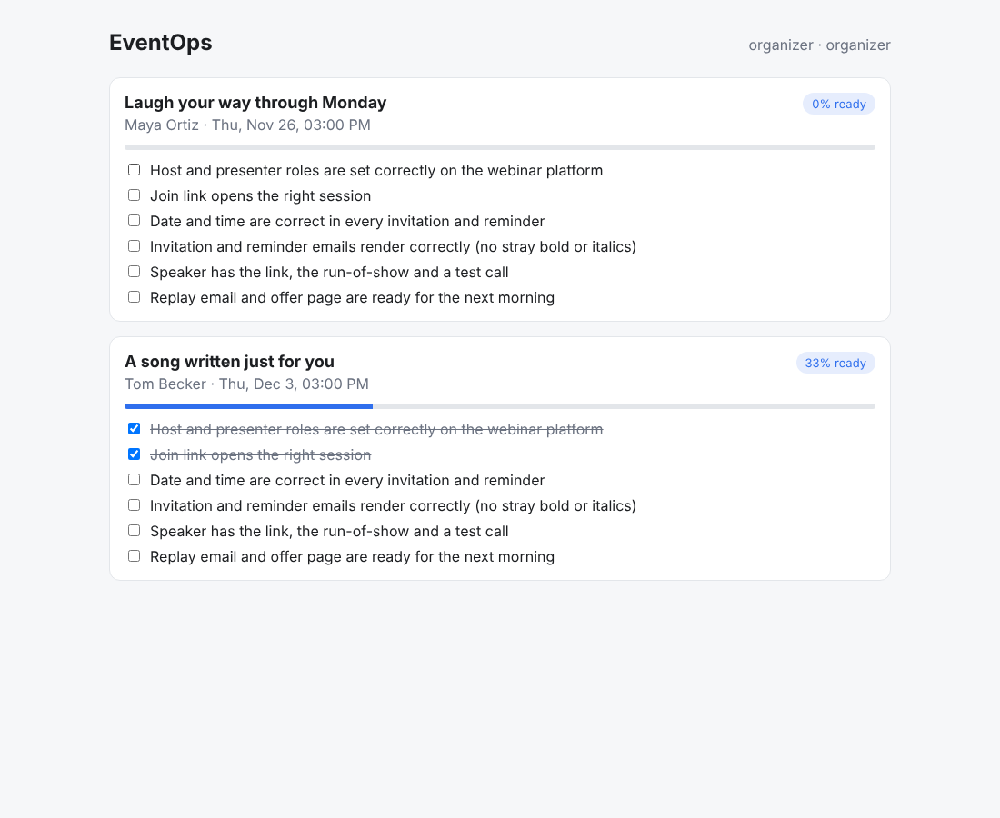

# EventOps

**The back-office for small teams that sell through live webinars.**

Many coaches, trainers and online academies run their business on webinars: invite the list, run the live session, send the replay and the offer, follow up until the offer closes. The tools exist (a webinar platform, an emailing tool, Stripe, a spreadsheet), but they don't talk to each other. The result is copy-pasting, manual checks, and boring failures that cost sales: host and presenter roles swapped, a broken join link, a wrong date in the invitation.

EventOps puts the operations in one place, starting with what breaks most often.



## What it does today

- **Events and speakers**: plan sessions, store join links and offer pages.
- **Pre-live checklist**: every new event gets a checklist built from real incidents (roles, join link, dates, email formatting, speaker briefing, replay). A readiness score shows at a glance whether a session is safe to go live.
- **Role-based access**: admins, organizers and hosts. Hosts can prepare and tick the checklist; only organizers create events; **only admins can export the contact list**, because for these businesses the mailing list is the main asset.
- **Contacts**: list size and consent stats for every member, CSV export for admins only.

## Roadmap

- [ ] Stripe sync: sales per event and per speaker
- [ ] Mailjet integration: send invitations and reminders without exposing the list
- [ ] LLM-assisted follow-up emails drafted from the offer page, reviewed by a human before sending
- [ ] Webinar platform sync (scheduled sessions, attendance)
- [ ] Timezone-aware scheduling UI and reminders

## Stack

| Layer | Tech |
|---|---|
| Backend | Python 3.12, Django 5, django-ninja (typed REST API, OpenAPI docs at `/api/docs`) |
| Frontend | React 18, TypeScript, Vite |
| Data | PostgreSQL (SQLite for quick local runs) |
| Quality | pytest, mypy + django-stubs, ruff, GitHub Actions |
| Delivery | Docker, Docker Compose, Kubernetes manifests |

## Run it locally

### With Docker Compose

```bash
cp .env.example .env   # then replace the three placeholder values
docker compose up --build
```

Open http://localhost:8080 and sign in with one of the demo users (`owner`, `organizer`, `host`), using the `DEMO_PASSWORD` you set in `.env`.

### Without Docker

```bash
# Backend
cd backend
python -m venv .venv && source .venv/bin/activate
pip install -r requirements-dev.txt
python manage.py migrate
python manage.py seed_demo
python manage.py runserver

# Frontend (in another terminal)
cd frontend
npm install
npm run dev
```

Open http://localhost:5173, then sign in through http://localhost:5173/admin/login/. `seed_demo` prints a generated login for the demo users (or uses `DEMO_PASSWORD` if it is set).

## Checks

```bash
cd backend
ruff check . && ruff format --check .
mypy .
pytest
```

## Deploy on Kubernetes

```bash
cp deploy/k8s/secret.example.yaml deploy/k8s/secret.yaml   # fill in real values
kubectl apply -f deploy/k8s/secret.yaml
kubectl apply -f deploy/k8s/backend.yaml -f deploy/k8s/frontend.yaml
```

Migrations run in an init container; both deployments expose health probes.

## Design notes

- **Business rules live in services, not views.** `apps/events/services.py` owns the checklist and readiness logic, so it is tested without HTTP.
- **Permissions are explicit functions** (`apps/accounts/permissions.py`), easy to read and to test.
- **Dates are stored in UTC** and rendered in the viewer's timezone, which avoids the classic "invitation shows the wrong day" bug.

## License

MIT, by [Léo Goubard](https://www.linkedin.com/in/leogoubard).
